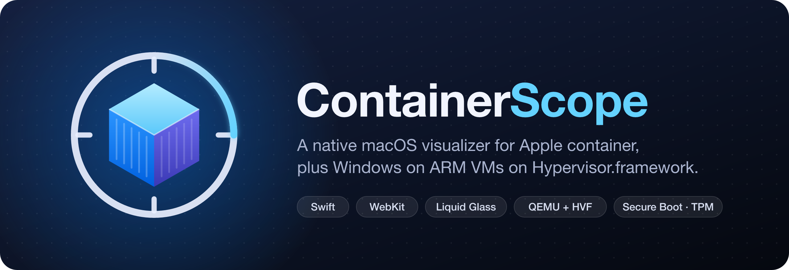

<p align="center"></p>

ContainerScope is a native macOS app (Swift + WebKit) for Apple's [`container`](https://github.com/apple/container) engine. It shows your containers, images, volumes, networks and engine health. It also runs Windows 11 on ARM virtual machines on Hypervisor.framework, with nothing between the app and the raw QEMU tools.

## Install

1. Download `ContainerScope-<version>.dmg` from [Releases](../../releases) and drag **ContainerScope** to **Applications**.
2. The app has an ad-hoc signature and isn't notarized, so the first time you open it, macOS blocks it. Go to **System Settings → Privacy & Security** and choose **Open Anyway**, or run:
   ```sh
   xattr -dr com.apple.quarantine /Applications/ContainerScope.app
   ```

Requires macOS 26 on Apple Silicon with Apple `container` installed (`brew install container`).

## What's inside

| Section | What it does |
|---|---|
| Overview, Containers, Images, Volumes, Networks | Live state and usage of everything the `container` engine manages |
| Machines | Linux machines, including nested virtualization |
| Kubernetes | Clusters running on the engine |
| Windows | Windows 11 on ARM VMs: QEMU + HVF, UEFI Secure Boot, swtpm TPM 2.0, NVMe disk, VirtIO network |
| Engine | Engine status, start/stop/restart, upgrades, kernel |

### Windows on ARM

- **Windows download:** the app gets fresh links to the official Microsoft Arm64 ISO for any version and language. It also downloads the Fedora VirtIO driver ISO. Both go to a temporary folder, and **Clean Up** deletes them when you're done.
- **Secure Boot firmware:** **Get Secure Boot Firmware** builds Ubuntu's `qemu-efi-aarch64` package from source inside your container engine, with the ContainerScope logo in place of TianoCore. Ubuntu's build flags and pre-enrolled Microsoft keys are kept as they are. The recipe is in [`Firmware/build-aavmf.sh`](Firmware/build-aavmf.sh); to run it by hand:
  ```sh
  container run --rm -c 8 -m 8G -v "$PWD/Firmware:/in:ro" -v "$OUT:/out" \
    docker.io/library/ubuntu:24.04 sh /in/build-aavmf.sh
  ```
- **Tools:** QEMU and swtpm come from Homebrew. **Install QEMU** in the app runs `brew install qemu swtpm`.

## Build

```sh
Scripts/build-app.sh      # build/ContainerScope.app (SwiftPM, no Xcode project)
Scripts/build-dmg.sh      # build/ContainerScope-<version>.dmg
```

To change the artwork, edit the SVGs in [`Artwork/`](Artwork). [`mark.svg`](Artwork/mark.svg) is the one source for the logo. Run `Artwork/render.sh` (needs `brew install resvg`) to regenerate `AppIcon.icns`, `hero.png` and `Firmware/Logo.png`.

## Releases

The version lives in [`VERSION`](VERSION). The build number is the git commit count.

```sh
Scripts/release.sh 0.2.0
```

This bumps `VERSION`, commits, tags `v0.2.0` and pushes. The tag starts the [Release workflow](.github/workflows/release.yml) on a `macos-26` runner, which:

1. Checks that the tag matches `VERSION`.
2. Builds the app and DMG.
3. Publishes a GitHub Release with the DMG, its SHA-256 and generated release notes.

Every push to `main` and every pull request runs [CI](.github/workflows/ci.yml), which uploads the DMG as a build artifact.
